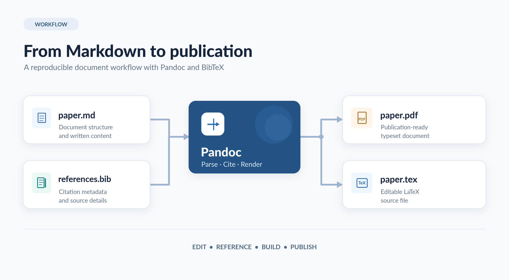

# Introduction

This is a template for writing documents in Markdown, managing references in
a BibTeX file, and generating a PDF (or LaTeX) with Pandoc. Edit this file
(`document/paper.md`) and your bibliography (`document/references.bib`), then
run the build script. See the top-level `README.md` for full instructions on
macOS and Windows.

You cite sources with the Pandoc citation syntax. A single citation looks like
this [@vanheesch2026]. You can combine several in one place [@vanheesch2026human; @theunissen2022mapping].
As van Heesch and colleagues showed [@vanheesch2026], templates save time.

# How This Works

The source of truth is this Markdown file plus the BibTeX file. Pandoc merges
them, resolves every `[@key]` into a numbered citation, and appends a formatted
reference list wherever the `# References` heading appears. Change the text,
rebuild, and the citations and bibliography update automatically.

## Headings and Structure

Use `#` for top-level headings, `##` for subsections, and so on. Keep one blank
line between paragraphs.

## Lists

Bullet list:

- First point
- Second point, with a reference [@theunissen2022mapping]
- Third point

Numbered list:

1. Step one
2. Step two
3. Step three

## Emphasis

Use *italics* with single asterisks and **bold** with double asterisks.

## Images

Embed an image with ``. Keep image files in the
`document/images/` folder and reference them relative to `paper.md`. Pandoc
places the image and renders the caption below it:

Replace `images/example.jpg` with your own figure and update the caption.

## Math

Pandoc renders LaTeX math. Write inline math between single dollar signs, e.g.
the mass–energy relation $E = mc^2$, and display math between double dollar
signs. For example, the arithmetic mean of $n$ values is

$$\bar{x} = \frac{1}{n} \sum_{i=1}^{n} x_i.$$

You can use the full range of LaTeX symbols, such as Greek letters ($\alpha$,
$\beta$, $\sigma$), fractions, sums, and integrals like
$\int_0^1 x^2 \, dx = \tfrac{1}{3}$.

# Conclusion

Replace this content with your own. Keep the YAML block at the very top (it sets
title, authors, margins, and font size) and keep the `# References` heading at
the very bottom.

# References
